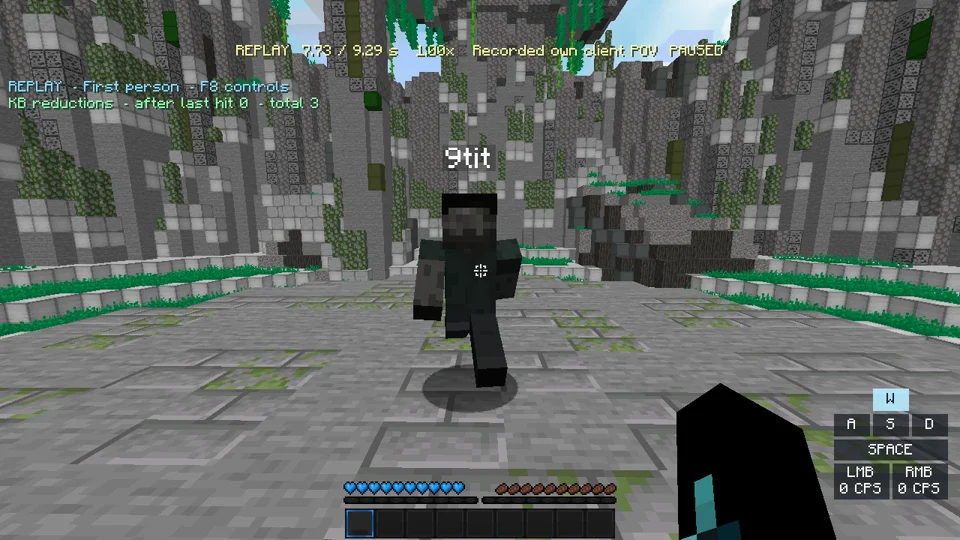
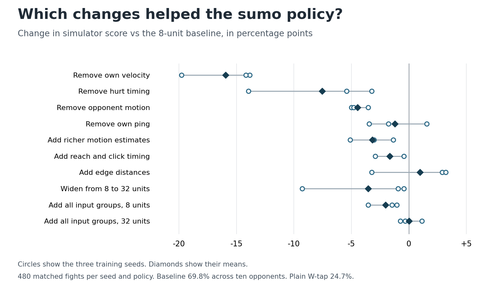

# Minecraft PvP Lab

A local practice server and research playground for **classic Minecraft Java 1.8.9 PvP**. Fight scripted and learned opponents, drill specific skills, and replay an exchange from each fighter’s point of view. A separate **Java 26.3 sword lab** studies modern combat.

[Quick start](#quick-start) · [Practice and replay](#practice-and-replay) · [Current work](#current-work) · [Repository guide](#repository-guide)



*The Forge practice client replaying a recorded sumo exchange. The guide walks through jump timing, sprint braking, and missed opportunities frame by frame. Download the folder and open the HTML page in a browser to use the interactive guide.* [Illustrated sumo trade review](recordings/mmc-trade-guide/index.html)

## Quick start

### Classic PvP on macOS

You need Python 3, a Java 17 JDK, and the official Minecraft launcher with **Minecraft Java 1.8.9** available. From the project folder, run:

```sh
python3 lab.py prepare
python3 lab.py build
python3 lab.py sandbox-test
python3 lab.py serve --bot-backend legacy
```

In Minecraft, open **Multiplayer → Direct Connect**, enter `127.0.0.1:25565`, and type `/bots` for the clickable opponent list. Keep Terminal open while you play. The **Start PvP Lab.command** launcher uses the default Forge bot backend. Its setup uses the launcher’s Java 8 runtime and the same practice bridge as the optional human client. [Full setup and backend guide](LAB-GUIDE.md#setup-and-checks)

### Modern sword combat on macOS

Open **Start Modern Sword Lab.command**, enter your player name, and select a fighter. When the launcher is ready, connect with **Minecraft Java 26.3** at `127.0.0.1:25663`. The modern lab uses a Lima Linux VM to run real Minecraft bots without opening game windows on your desktop. [Prerequisites, launcher options, and benchmarks](research/sword26/README.md)

## Practice and replay

| In Minecraft 1.8.9 | What it does |
| --- | --- |
| `/duel wtap` | Box against the plain W-tap baseline. First to 100 accepted hits wins. |
| `/duel wtap sumo preset=mmc` | Play for a ring-out on the recorded 13×13 MMC platform, with 137 floor blocks and spawns eight blocks apart. |
| `/duel wtap diamond` | Fight to death in full diamond armor with wooden swords. The `rod_diamond` kit adds a fishing rod. |
| `/drill jumpreset` | Repeat sumo rounds with feedback on when you jumped relative to incoming knockback. |
| `/rematch`, `/replay`, `/watch` | Repeat the setup, replay a completed match, or spectate a live one. |
| `/help settings` | Find options for per-player latency, bot reach, click-rate limits, aim, and hit timing. |

The optional **Forge 1.8.9 practice mod** adds ToggleSprint, an editable HUD, reach and spacing overlays, and combat timing feedback. Lab replays can switch between the human, bot, and server viewpoints and step through recorded events. The client also supports opt-in recording on other servers and an offline replay viewer. [Practice mod setup and controls](practice-client/README.md)

| Reach in a recorded sumo exchange | What the sumo learner uses |
| --- | --- |
| [](recordings/m2151-reach-advantage.png) | [](research/elite-league/sumo-inputs/feature-effects.png) |
| The two fighters’ views separate enough for only one to be within reach during part of this exchange. | Removing own velocity or hurt timing hurt the learned fighter in this simulator study. [Study and native checks](research/elite-league/sumo-inputs/README.md) |

## Current work

*Research snapshot · November 20, 2026*

- **Adaptive 7-CPS sumo.** The proposed single-duel league would train a main fighter and a counter against an archive of earlier policies. A recent audit compared W-tap variants and identified which ones could share a training slot. The next research question is whether a fighter with memory can recognize and adapt to an opponent during one duel. In the completed native cap study, `sumo-seven-first` went 32–0 against frozen `best-sumo` at 7 CPS, while plain W-tap went 0–8. The same specialist went 10–22 at 20 CPS, where W-tap went 1–7. [League plan](research/elite-league/sumo-league-proposal.md) · [Matched-cap study](research/elite-league/sumo-confidence/seven/pilot/cap-transfer-results.md)
- **Modern sword league.** Repeated training produces generalists and challengers to the current champion. Promotion depends on ordinary Java matches on fresh openings at both tested latencies. The first promoted challenger won 24 of 32 fights across two opponents, where W-tap won 10 of 32. It is available as launcher option 6. The league continues to investigate where simulated and native timing produce different outcomes. [League log](research/sword26/LEAGUE.md) · [Simulator and timing checks](research/sword26/SIMULATOR.md)
- **Boxing openings and combo maintenance.** Research isolates when delaying the first hit can create a double, when a jump can escape an incoming combo, and what preserves a combo once established. Regulation boxing uses first-to-100 score margin. The separate maintenance test starts from an unanswered-hit landmark and checks the next native damage windows and accepted return hits. [Boxing trade studies](research/elite-league/boxing-trade-skills.md) · [Current research brief](research/combo-research-brief.md)
- **Sumo coaching and replay.** Recent work traced backward slides to sprint state, click timing, and jump timing. Planned coaching would use sounds or flashes to grade a trade you just played, with replay evidence showing which braking opportunities you connected with or missed. [Illustrated trade review](recordings/mmc-trade-guide/index.html) · [Existing client tools](practice-client/README.md)

## How the experiments work

The classic lab runs the official 1.8.9 server and real game clients through HeadlessMC. Separate client-visible views matter because packet delay can give two players different pictures of the same fight. Playable research policies observe their own client and issue ordinary movement, mouse, and click inputs. Simulators accelerate search and allow comparisons from the same complete saved state. Native repeats use matched settings with independently realized timing.

Plain **W-tap**, a brief release and re-press of forward to reset sprint, is the comparison baseline in both environments. The research brief specifies how to match settings, separate training from held-out timing, and grade boxing and sumo under their own win conditions. The MMC knockback preset is an approximation calibrated against recordings. [Research method and evidence](research/README.md) · [Formal combat model](FORMAL-MODEL.md) · [Measured sumo platform](research/mmc-arena/README.md)

## Repository guide

| Where to look | What’s inside |
| --- | --- |
| [Lab handbook](LAB-GUIDE.md) | Full command reference, combat rules, setup, and historical experiments. |
| [`src/`](src/) and [`lab.py`](lab.py) | Java game hooks and controllers, plus the Python build and lab entry point. |
| [`practice-client/`](practice-client/) | Forge client mod, shared bot bridge, recording and replay tools, and mod checks. |
| [`policies/`](policies/) and [`seeds/`](seeds/) | Bot settings and saved scenario seeds. |
| [`research/`](research/) | Mechanics, simulator checks, experiment protocols, and the [classic learning league](research/elite-league/README.md) and [modern sword lab](research/sword26/README.md). |
| [`experiments/`](experiments/) and [`recordings/`](recordings/) | Trial results, sample traces, and replay artifacts. Open downloaded HTML replays in a browser. |
| [`tests/`](tests/) and [security model](SECURITY.md) | Verification programs, dependency pinning, loopback networking, and sandbox design. |

Run the model, replay, and trade checks from the project folder:

```sh
python3 -m unittest -v test_model test_replay_combos test_trade
```
