# Minecraft PvP Lab

A collection of AI, physics, and practice-tool explorations built around **Minecraft Java 1.8.9** and **modern Minecraft (Java 26.3)** combat.

Fight self-play bots locally, replay exchanges from every player's point of view, train neural networks on real gameplay captures, and reverse-engineer the exact tick-by-tick physics that decide fights.

[Explore the Projects](#explore-the-projects) · [Interactive Browser Demos](#interactive-browser-demos) · [How Minecraft PvP Actually Works](#how-minecraft-pvp-actually-works) · [Run It Locally](#run-it-locally) · [Repository Map](#repository-map)

<p align="center">
  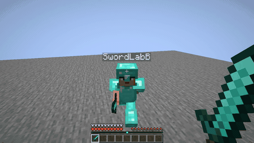
  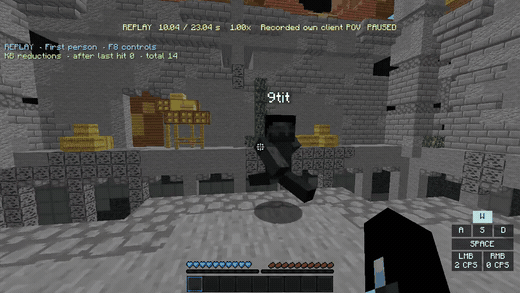
</p>

<p align="center">
  <em>Left: Modern Sword League champion fighting inside real Minecraft Java 26.3. &nbsp;·&nbsp; Right: Classic 1.8.9 Forge practice client replaying a Minemen Club Sumo exchange with recorded keystrokes and knockback-brake telemetry.</em>
</p>

---

## Interactive Browser Demos

Want to see the mechanics and AI replays right away without installing Minecraft? Enable GitHub Pages on `docs/` (or open the HTML files locally in any browser):

| Interactive Demo | What You Can Do | Open |
| --- | --- | --- |
| **Why You Flew Back (Sumo Trade Guide)** | Scrub frame-by-frame through real Minemen Club sumo trades to see how early jumps, W-releases, and sprint-braking decide ring-outs. | [`docs/sumo-trade-guide/index.html`](docs/sumo-trade-guide/index.html) |
| **Movement & Knockback, One Tick at a Time** | Step through exact 1.8.9 tick math, toggle sprint-contact braking on/off, and inspect every floating-point velocity update. | [`docs/movement-and-knockback.html`](docs/movement-and-knockback.html) |
| **3D Bow Duels League Replay Viewer** | Watch evolved AI archers strafe around cover pillars and trade curved arrows from orbit or first-person POV. | [`docs/bow-duels-viewer/index.html`](docs/bow-duels-viewer/index.html) |

*(Hub page for GitHub Pages: [`docs/index.html`](docs/index.html))*

---

## Explore the Projects

This repository grew into six main projects sharing the same packet capture pipeline, physics engines, and Minecraft test harness.

### 1. Practice Lab, Slow-Motion Sumo & Forge 1.8.9 Mod
A local practice server plus a custom Forge 1.8.9 client mod designed to make invisible combat mechanics visible.
- **Slow-motion Sumo:** Slow the entire game (physics, bot CPS, and simulated ping) down to `0.10×–1.00×` speed to practice timing in real time, adjustable mid-duel from the pause menu.
- **Two-POV overlays:** Live translucent reach spheres, crosshair range brackets, and a ghost silhouette showing *where the opponent's delayed client currently sees you*.
- **Sumo Coach & Offline Replay Viewer:** Live visual/audio feedback on knockback braking, post-match biggest-slide diagnosis, and a built-in offline replay viewer that reconstructs recorded matches and switches between Human, Bot, and Server POVs.

→ [Practice mod commands & controls](practice-client/README.md) · [Full lab handbook](docs/LAB-GUIDE.md)

---

### 2. Neural Bow Aim & Tactical Void-KB Engine
Predicting where a dodging player will be half a second from now—especially on narrow bridges and islands—is far harder than straight-line extrapolation. We trained lightweight PyTorch neural networks directly on **1.23 million ticks of real Hypixel BedWars and SkyWars captures** (no synthetic data) and exported them to pure Java 8 (`<1.5 ms` per target, exact Python↔Java parity to `1e-5`).

- **Multi-mode + 3D terrain voxels:** Instead of guessing one average path, the model reads a local 3D solid-block voxel grid around the target and predicts **6 distinct movement modes** (e.g., keep running, strafe back, jump, duck behind cover), then picks the aim angle maximizing hit probability across all modes and arrow spread.
- **Tactical void-kill & wait timing:** Models 14 ticks of exact 1.8.9 knockback and void edges (`VoidKbValue`) plus a learned continuation-value head (`V_wait`) that holds a shot for a few ticks when waiting raises expected value (lifting void kills/10 shots by **+11.8%** on void-exposed targets), plus multi-projectile snowball/egg volley coverage.

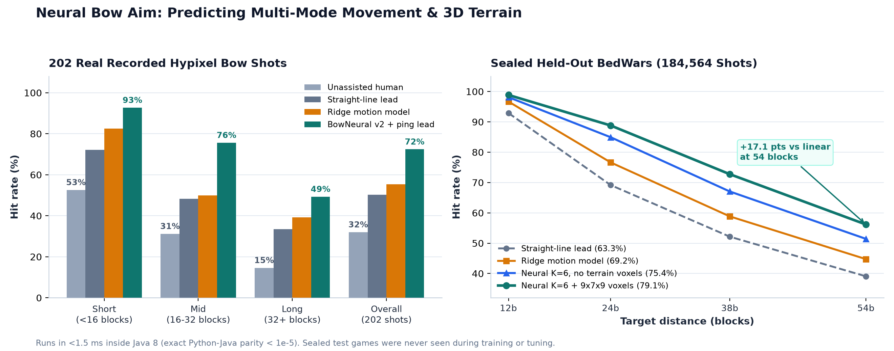

→ [Neural Bow Aim benchmarks (v1–v3 & v4)](research/bow-aim/neural/RESULTS.md) · [Baseline & native Forge tests](research/bow-aim/RESULTS.md)

---

### 3. 1.8.9 Sumo & Boxing Physics + Self-Play RL League
How far can reinforcement learning and search go in classic 1.8.9 combat when bots can only observe their own client screen and press ordinary movement/click keys?

- **Reconstructed real arenas:** Decoded 430 recorded Minemen Club sumo matches to rebuild all **9 distinct floor outlines and 28 block-exact variants** directly from protocol packets, verified against vanilla `Entity.moveEntity`.
- **Matched-cap RL champions:** In matched 7-CPS native Minecraft trials, learned sumo specialists went **32–0** against the previous frozen champion (where plain W-tap went **0–8**). Every controller is gated against plain **W-tap** under identical reach, ping, and CPS limits.
- **Boxing mechanics isolation:** Separate studies isolate hit-selection timing, jump-reset escapes, and established-combo maintenance from identical forked mid-combo states.

<p align="center">
  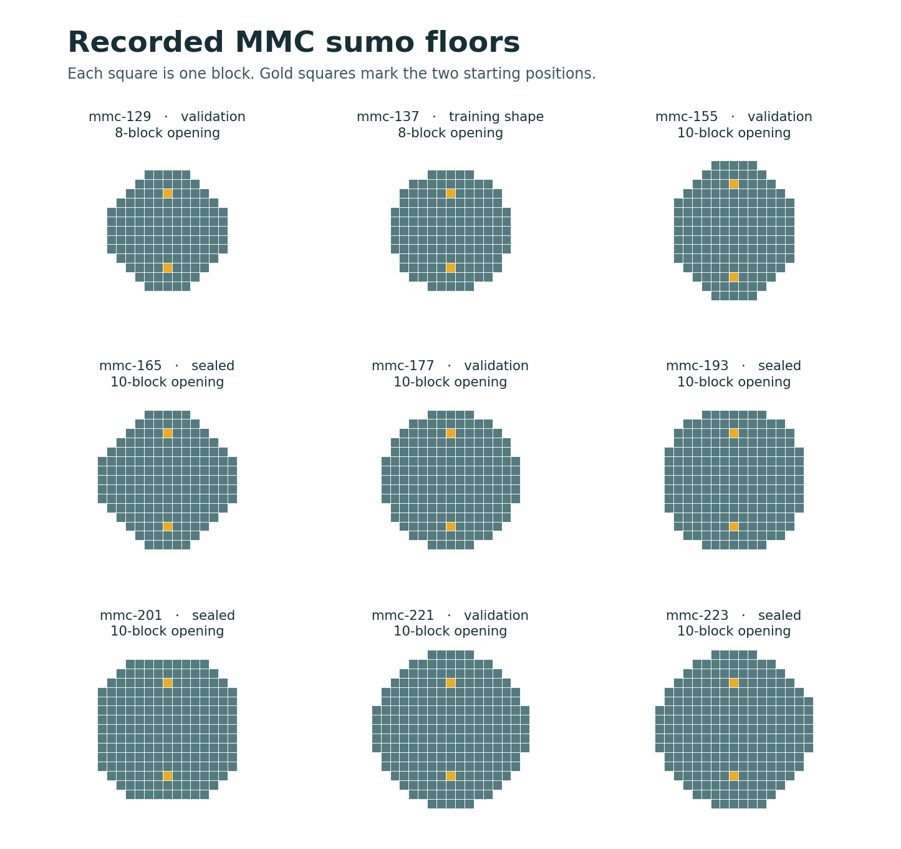
  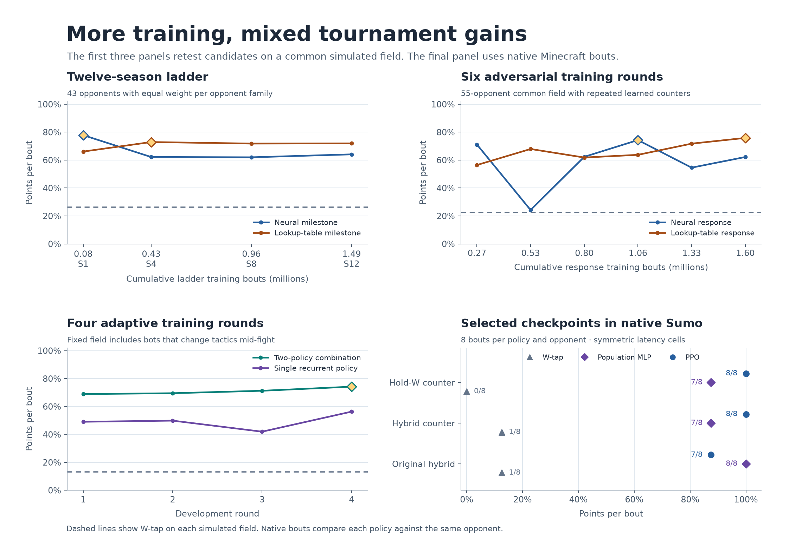
</p>

→ [Classic RL league & tournaments](research/elite-league/README.md) · [Reconstructed MMC arenas](research/mmc-arena/README.md) · [Sumo replay analysis](research/sumo-replay-analysis/README.md)

---

### 4. Modern Minecraft (Java 26.3) Sword Combat League
A separate self-play league for modern cooldown-based sword combat, complete with a fast JVM flat-court simulator, an automated promotion ladder verified in real headless Minecraft Java 26.3 clients (inside a Linux VM on macOS), and a local 720p60 match dashboard.

- **Learned emergent tactics:** Self-play policies trained from scratch independently discovered **jump-resetting** on incoming knockback and spacing traps around attack cooldowns.
- **Native Java promotion gate:** Every challenger must beat the incumbent and plain W-tap on fresh openings across both tested latencies in real Minecraft before earning the title (the first promoted challenger went **24–8**, vs. **10–22** for W-tap).

→ [Modern sword lab setup, league log & simulator parity](research/sword26/README.md)

---

### 5. Rust-Accelerated Bow Duels Self-Play League
A standalone adversarial league for 1v1 bow duels (bows, cover pillars, knockback, and ender pearls).

- **105,000 arena ticks/sec:** A custom AVX2 Rust geometry and raycasting backend (`geometry.rs`) steps batched arenas **12× faster than NumPy** while matching real Forge 1.8.9 movement within `4.2e-6` blocks and arrow hit/miss outcomes identically.
- **Counter-training loop:** Every generation spawns specialized counter-agents trained specifically to exploit the current champion's weaknesses, then evolves new generalists (MLP, GRU, and future-position forecasting GRUs) against the growing threat archive.

<p align="center">
  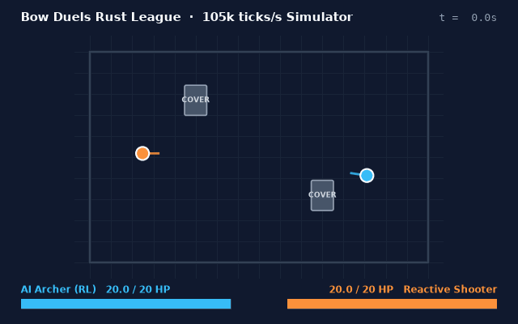
  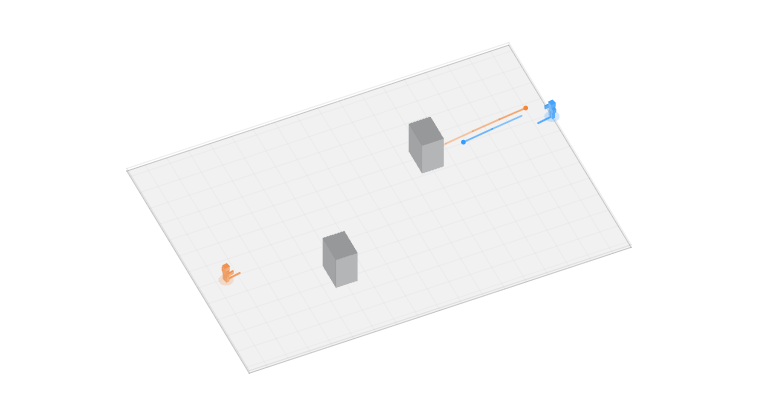
</p>

→ [Bow Duels architecture & Rust benchmarks](research/bow-duels/README.md) · [Open 3D replay viewer](docs/bow-duels-viewer/index.html)

---

### 6. BedWars 3D Player Location Forecasting
An ML and visualization experiment asking: *given only what one player's client observes during a BedWars match, how accurately can you forecast where every player on the map will be 5, 10, 30, 60, or 120 seconds later?*

- **Online habit adaptation:** Combines global movement priors with a per-player memory built live during the match (recent trails, favorite hotspots, repeated bridge routes, and inferred home base). At 60 seconds late in held-out games, adapting to each player's habits assigns **6.0× higher geometric mean probability** to the exact future 3D block than a static heatmap.
- **3D visualizers:** Rendered both in-game (3D translucent volumes & predicted silhouettes) and in a Three.js map viewer. In real gameplay it turned out to be much more interesting as a spatial forecasting and visualization experiment than a practical in-game advantage—humans already intuit coarse map flow, while fine-grained uncertainty spreads quickly past 30 seconds.

<p align="center">
  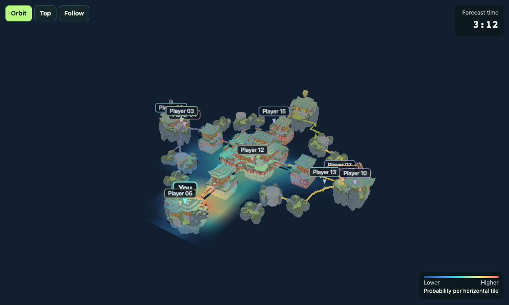
  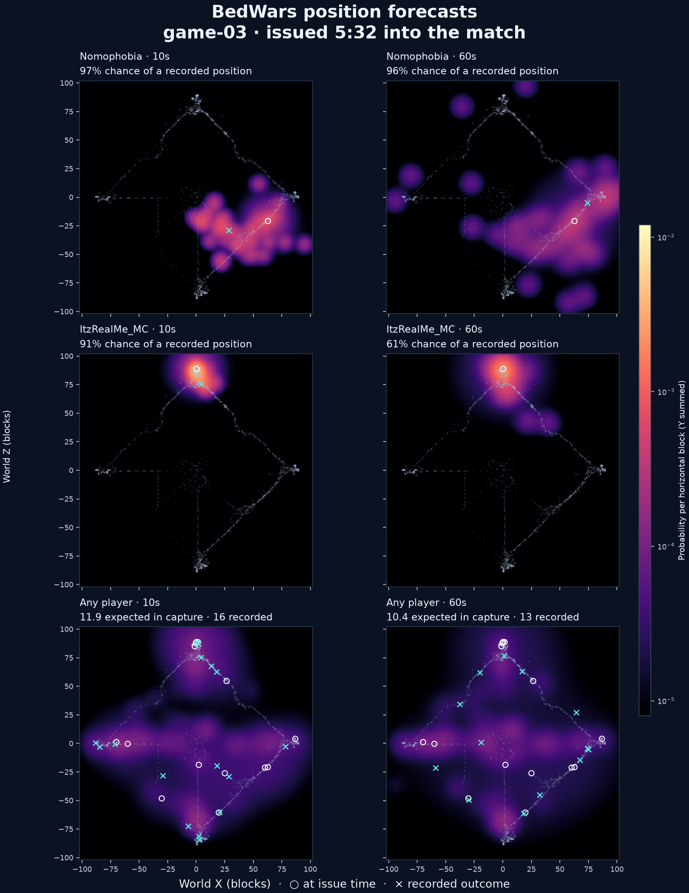
</p>

→ [BedWars forecasting study & results](research/bedwars-forecast/README.md) · [Within-match adaptation follow-up](research/bedwars-forecast/context-study/RESULTS.md)

---

## How Minecraft PvP Actually Works

Once you start recording packets from both clients and the server at the same time, a few counterintuitive mechanics explain most of what feels mysterious in-game:

### 1. Lag creates two different realities (the reach gap)
In Minecraft, hit detection runs on *your* client's view of where the opponent is right now—which is delayed by network latency and 3-tick entity interpolation. When you knock someone backward and chase them, **your screen sees them closer than their screen sees you**.

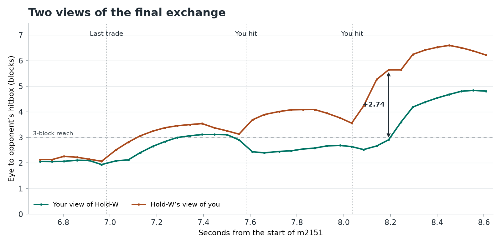

*In a real recorded exchange (`m2151`), the green curve (attacker's view) stays inside the 3.0-block reach line while the orange curve (defender's view) drifts **+2.74 blocks** farther away—making the fight briefly one-sided purely through motion + delay.*

### 2. Knockback braking & tick-level physics
In 1.8.9, landing a melee attack while sprinting multiplies your *own* horizontal velocity by **0.6×**—even if the opponent is currently invulnerable! Clicking on target immediately after taking knockback acts as an emergency brake that cuts your backward slide dramatically, whereas releasing **W** too early or jumping at the wrong tick can send you flying off a sumo platform.

<p align="center">
  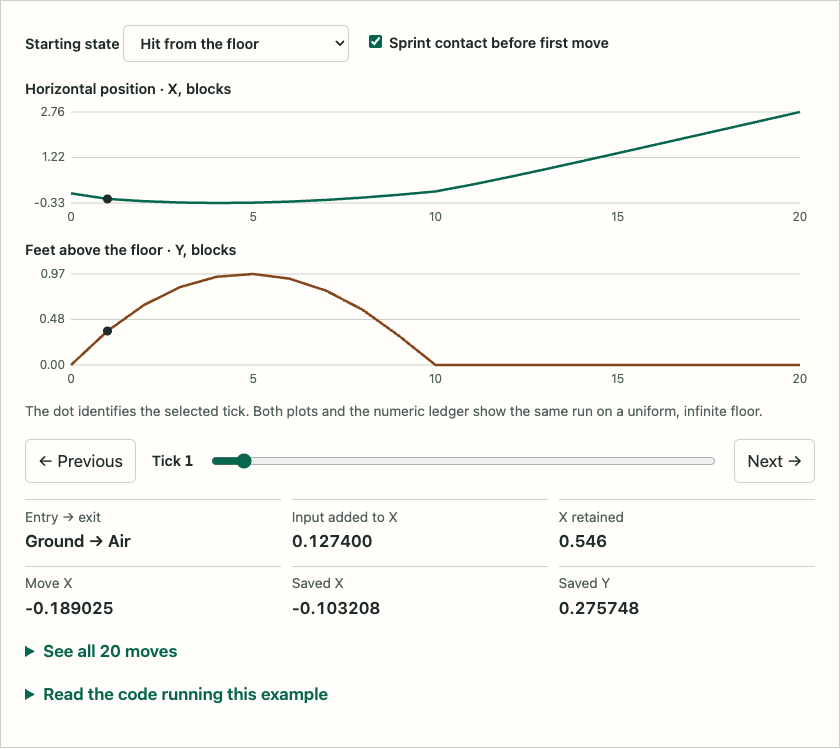
</p>

*Explore this yourself in the [interactive tick-by-tick physics simulator](docs/movement-and-knockback.html) or step through real match clips in the [Sumo Trade Guide](docs/sumo-trade-guide/index.html).*

### 3. The Lab Pipeline (How the AI Gets Trained & Verified)

Most of the projects here follow the same four-stage loop so simulator speed never sacrifices real-game honesty:

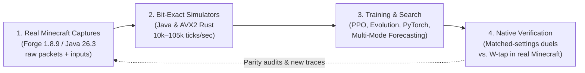

---

## Run It Locally

### Prerequisites (macOS)
- **Python 3**, **Java 17 JDK**, and the official Minecraft launcher with **Minecraft Java 1.8.9** (for the classic lab) or **Java 26.3** (for the modern sword lab).

### Classic 1.8.9 Practice Lab
```sh
python3 lab.py prepare
python3 lab.py build
python3 lab.py sandbox-test
python3 lab.py serve --bot-backend legacy
```
Connect in Minecraft 1.8.9 to **`127.0.0.1:25565`** and run:
- `/bots` — clickable menu of baselines and trained champions
- `/duel wtap` or `/duel best-sumo sumo preset=mmc` — fight on the reconstructed 13×13 MMC platform
- `/drill jumpreset` — drill jump-reset timing against incoming knockback
- `/replay` — replay your last duel from Human, Bot, or Server POV

### One-Click macOS Launchers
- **[Start PvP Lab.command](Start%20PvP%20Lab.command)** — launches the main 1.8.9 practice server with the Forge bot backend
- **[Start Slow Sumo.command](Start%20Slow%20Sumo.command)** — launches slow-motion sumo (`0.10×–1.00×` speed) on `127.0.0.1:25585`
- **[Start Modern Sword Lab.command](Start%20Modern%20Sword%20Lab.command)** — fight the Java 26.3 sword champions on `127.0.0.1:25663`
- **[Watch Sword League.command](Watch%20Sword%20League.command)** — opens the local 60fps Sword League match viewer

### Run the Test Suite
```sh
python3 -m unittest discover -s tests -v
```

---

## Repository Map

| Path | What's Inside |
| --- | --- |
| [`lab.py`](lab.py) & [`slow_sumo.py`](slow_sumo.py) | Main 1.8.9 lab server launcher and slow-motion sumo room |
| [`practice-client/`](practice-client/) | Forge 1.8.9 practice mod (HUD, overlays, Sumo Coach, BowAim, BedWars overlay, offline replay viewer) |
| [`src/`](src/) | Core 1.8.9 Java server hooks, exact movement kernels, and bot controllers |
| [`research/`](research/) | Flagship research projects: [`bow-aim/`](research/bow-aim/), [`bow-duels/`](research/bow-duels/), [`bedwars-forecast/`](research/bedwars-forecast/), [`elite-league/`](research/elite-league/), [`sword26/`](research/sword26/), [`mmc-arena/`](research/mmc-arena/), [`sumo-rl/`](research/sumo-rl/), [`sumo-replay-analysis/`](research/sumo-replay-analysis/) |
| [`docs/`](docs/) | GitHub Pages interactive demos (`sumo-trade-guide/`, `bow-duels-viewer/`, `movement-and-knockback.html`), README assets, and deep docs ([Lab Guide](docs/LAB-GUIDE.md), [Formal Model](docs/FORMAL-MODEL.md), [Theory](docs/THEORY.md), [Security](docs/SECURITY.md)) |
| [`tools/`](tools/) | Replay tools, POV archive exporter, match ledger generator, and combat-window analyzers |
| [`policies/`](policies/) & [`seeds/`](seeds/) | Curated playable bot baselines, league champions, and scenario seeds |
| [`tests/`](tests/) | Python and Java unit/parity verification tests |
