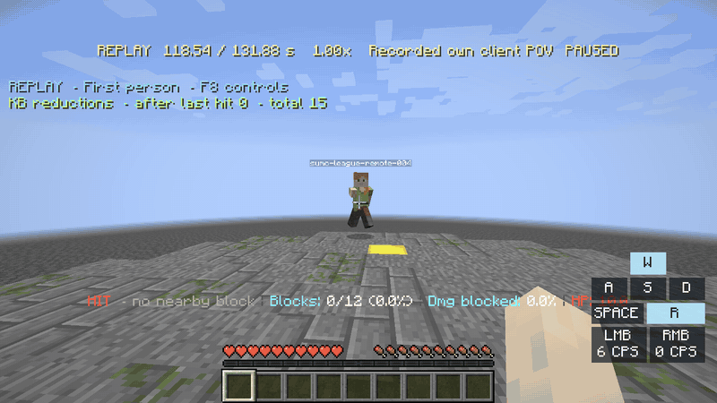
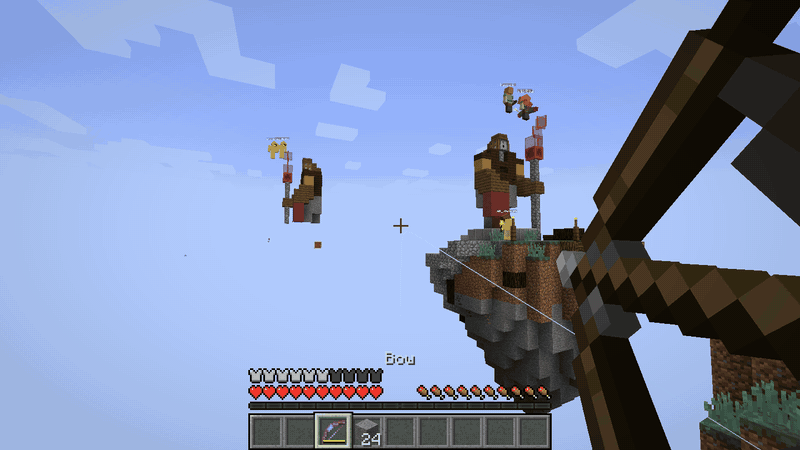
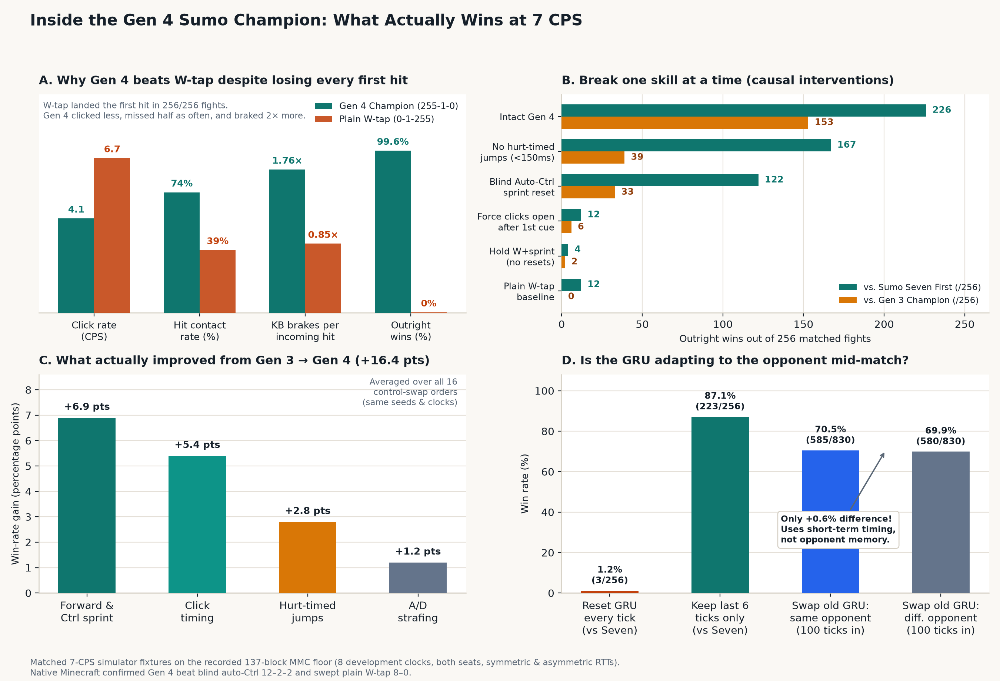

# Minecraft PvP Lab

A personal lab of AI, physics, and practice-tool explorations built around **Minecraft Java 1.8.9** (and a small side digression into modern **Java 26.3**).

This isn't a neat single-purpose library—it's a collection of projects I built around two things I was genuinely curious about:
1. **How far out does the skill ceiling for 1.8.9 Sumo actually go?** (and how can I use real packet replays, slow-motion practice, and RL bots to understand it and get better myself?)
2. **Predicting opponents in real time:** bows over bridges and void edges, strafe patterns in bow duels, and whether bots can learn to read and break an opponent's pattern.

**[Read the full visual writeup & interactive demos →](https://ulissemini.github.io/mc-pvp/)** *(or open [`docs/index.html`](docs/index.html) locally)*

<p align="center">
  
  
</p>

<p align="center">
  <em>Left: A Sumo fight replayed in Forge 1.8.9 with recorded keystrokes and knockback feedback. &nbsp;·&nbsp; Right: Neural Bow Aim forecasts overlaid on a recorded SkyWars void kill.</em>
</p>

---

## Start Here (Pick Your Entrypoint)

- **[1.8.9 Sumo & The Skill Ceiling](https://ulissemini.github.io/mc-pvp/sumo.html)** ([`docs/sumo.html`](docs/sumo.html)) — What kicked this off (watching the #1 Sumo player in [this video](https://youtu.be/cVK9z1SRGu4) and [this insane 0:58 sideways-KB edge flick](https://youtu.be/46nk9OZsSbE?t=58)), why releasing W right when you get hit ruins your knockback brakes, and a full causal dissection of how our 7-CPS RL champions crush W-tap (`255–0–1`)—including the surprising **Ctrl sprint-key reset** discovery and why mid-match adaptation is still an open mystery.
- **[Neural Bow Aim & Void-Kill Timing](https://ulissemini.github.io/mc-pvp/bow-aim.html)** ([`docs/bow-aim.html`](docs/bow-aim.html)) — Predicting where dodging players will be when an arrow arrives using `K=6` multi-mode trajectories, 3D terrain voxels, and a learned `V_wait` head that holds fire a split second for void kills (`32%` raw / `50%` linear → `72%+` on 202 real Hypixel shots, running in `<1.5 ms` inside Java 8).
- **[Side Explorations](https://ulissemini.github.io/mc-pvp/side-projects.html)** ([`docs/side-projects.html`](docs/side-projects.html)) — Curiosity detours into prediction: a **105k ticks/s Rust Bow Duels league**, a **Modern Sword (26.3)** digression where self-play independently discovered jump-resetting (`624/624` hurt ticks) and a delayed-crit counter (`210/214` crits), and **BedWars 3D habit heatmaps** (`6.0×` probability lift at 60s, though honestly not very useful in actual play).
- **[Play Locally & Forge Mod Guide](https://ulissemini.github.io/mc-pvp/play.html)** ([`docs/play.html`](docs/play.html)) — Fight the bots locally, play slow-motion Sumo (`0.10×–1.00×` speed), drill jump-resets and KB braking, and scrub multi-POV replays.

---

## Interactive Browser Demos

No Minecraft install required—open directly via GitHub Pages (or locally from `docs/`):

| Demo | What You Can Try | Link |
| --- | --- | --- |
| **Why You Flew Back (Sumo Trade Guide)** | Scrub frame-by-frame through real Minemen Club trades (early jumps, W-release traps, miss cooldowns, KB brakes). | [`docs/sumo-trade-guide/index.html`](docs/sumo-trade-guide/index.html) |
| **Movement & Knockback, One Tick at a Time** | Step through exact 1.8.9 physics ticks and toggle 0.6× sprint-contact braking on/off. | [`docs/movement-and-knockback.html`](docs/movement-and-knockback.html) |
| **3D Bow Duels League Viewer** | Watch evolved neural archers fight around cover pillars from orbit or first-person POV. | [`docs/bow-duels-viewer/index.html`](docs/bow-duels-viewer/index.html) |

---

## A Few Cool Findings at a Glance

- **Don't W-tap the instant you get hit (human takeaway):** Dropping W right on incoming knockback turns off sprint during your backward slide, killing your **0.6× horizontal KB brakes**—the highest-value brakes in Sumo. Keep W+sprint held through the incoming hit to brake first, *then* reset.
- **Tapping Sprint (Ctrl) instead of W-tapping:** The learned 7-CPS Gen 4 Sumo champion (`sumo-league-remote-004`) resets sprint by tapping **Ctrl** while holding forward—and beat plain W-tap **255–0–1** (8–0 in real Minecraft) despite losing the first hit in all 256 games, mostly through click discipline (`4.1` vs `6.7` CPS, `74%` vs `39%` contact rate) and **2× more KB brakes per hit**. Yet hard-coding *blind* auto-Ctrl after every hit lost `2–12` in real Minecraft because selective timing matters!
- **Still no clear mid-match adaptation in RL Sumo:** Swapping Gen 4's older GRU hidden state from a *different* opponent vs. the *same* opponent gave `580/830` vs. `585/830` wins—recurrence drives short-term tick timing (last 6 ticks), not opponent pattern reading yet.
- **3D voxels + multi-mode prediction transform bow aiming:** Adding local 3D solid-block voxels and `K=6` trajectory modes lifted sealed BedWars accuracy to **79.1%** (+17.1 pts over straight-line aiming at 54 blocks), and `V_wait` lifted void kills/10 shots by **+11.8%** on void-exposed targets.



---

## Quick Start (macOS)

Requires **Python 3**, **Java 17 JDK**, and the official Minecraft launcher with **Minecraft Java 1.8.9**:

```sh
python3 lab.py prepare
python3 lab.py build
python3 lab.py sandbox-test
python3 lab.py serve --bot-backend legacy
```

Join `127.0.0.1:25565` in Minecraft 1.8.9 and type `/bots`, `/duel wtap sumo preset=mmc`, `/duel sumo-league-remote-004 sumo preset=mmc`, `/drill jumpreset`, or `/replay`.
For slow-motion Sumo (`0.10×–1.00×`), open **[Start Slow Sumo.command](Start%20Slow%20Sumo.command)** and join `127.0.0.1:25585` with the [Forge 1.8.9 practice mod](practice-client/README.md).

Run the test suite:
```sh
python3 -m unittest discover -s tests -v
```

---

## Repository Map

| Path | What's Inside |
| --- | --- |
| [`docs/`](docs/) | Unified GitHub Pages writeups (`sumo.html`, `bow-aim.html`, `side-projects.html`, `play.html`), interactive demos, charts/GIFs, and deep handbooks ([Lab Guide](docs/LAB-GUIDE.md), [Formal 1.8.9 Model](docs/FORMAL-MODEL.md), [Theory](docs/THEORY.md)) |
| [`lab.py`](lab.py) & [`slow_sumo.py`](slow_sumo.py) | Local 1.8.9 practice server and slow-motion sumo room |
| [`practice-client/`](practice-client/) | Custom Forge 1.8.9 mod (Sumo Coach, reach spheres & delayed ghosts, offline multi-POV replay viewer, Neural BowAim, BedWars overlay) |
| [`research/`](research/) | Standalone research code & logs: [`bow-aim/`](research/bow-aim/), [`elite-league/`](research/elite-league/), [`mmc-arena/`](research/mmc-arena/), [`bow-duels/`](research/bow-duels/), [`sword26/`](research/sword26/), [`bedwars-forecast/`](research/bedwars-forecast/), [`sumo-rl/`](research/sumo-rl/), [`sumo-replay-analysis/`](research/sumo-replay-analysis/) |
| [`src/`](src/), [`tools/`](tools/), [`policies/`](policies/), [`tests/`](tests/) | Core Java 1.8.9 server/bot hooks, replay/ledger utilities, curated playable bot configs, and parity tests |
