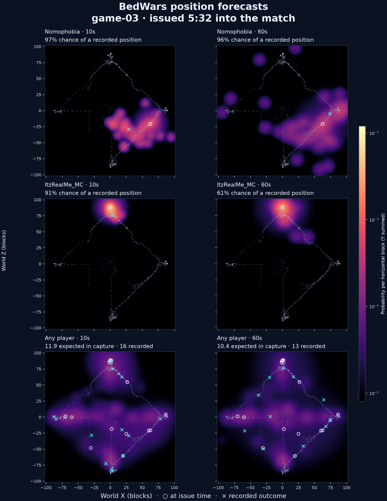

# BedWars location forecasts

See the [within-match movement study](context-study/RESULTS.md) for the
twelve-match follow-up, the altitude audit, and the live 3D rendering checks.

Five captured BedWars matches from November 20–21, 2026 contributed 1,919 one-second snapshots and 20,587 position observations from 64 unique accounts. Two matches were only partly recorded. The benchmark scored 15,204 to 20,356 individual forecast starts and 277 to 381 anonymous forecast starts per horizon. Most second-by-second forecasts came from the longest match. The headline scores give each held-out match equal weight. The final refits use personal history for 64, 63, 60, 60 and 45 accounts at 5s, 10s, 30s, 60s and 120s respectively.

## Individual forecasts on held-out matches

All numbers below are exact-block log loss in nats per recorded future position. Lower is better. A reduction of 0.60 nats corresponds to about 1.8 times the geometric mean probability on the actual block.

| Horizon | Stay | Constant velocity | Learned drift | Motion mixture | Best |
| --- | ---: | ---: | ---: | ---: | --- |
| 5s | 10.07 | 10.19 | 9.75 | **9.22** | Motion mixture |
| 10s | 11.58 | 11.98 | 11.18 | **10.98** | Motion mixture |
| 30s | 12.95 | 14.38 | **12.42** | 12.72 | Learned drift |
| 60s | 13.38 | 15.74 | **12.92** | 13.10 | Learned drift |
| 120s | 13.52 | 16.94 | **13.03** | 13.29 | Learned drift |

- At 10s the motion mixture beat Stay in all five matches, by 0.23 to 1.00 nats. Removing the recent motion features worsened its mean loss from 10.98 to 11.28. Removing context while keeping motion cost 0.07 nats. The mixture retains different possible destinations, which helps when a player could stop, turn, or continue.
- At 60s learned drift beat Stay in all five matches, by 0.38 to 0.57 nats. The motion mixture was better on spatial closeness at that horizon. Its Gaussian score was 0.933, compared with 0.966 for Stay and 0.966 for learned drift. Straight-line extrapolation lost to Stay at every horizon.
- The learned chance of seeing an opponent again was weaker on held-out matches than the simple horizon-specific rate. At 60s the learned opponent visibility log loss was 0.461 and the simple rate scored 0.439. Location gains and visibility gains are measured separately in the results.

## What the personal forecasts learned

These comparisons use the same later examples for all models and average each eligible player and game equally. Eligibility for this table requires at least 20 observed labeled examples before the split and at least 20 afterward. Models with shorter histories use more of the shared forecast. The 120s row comes from two matches.

| Horizon | Eligible player and game pairs | Stay | Shared motion mixture | Personal hotspots | Personal routes |
| --- | ---: | ---: | ---: | ---: | ---: |
| 5s | 44 | 10.30 | 9.54 | 9.65 | **9.44** |
| 10s | 44 | 11.95 | 11.58 | 10.64 | **10.62** |
| 30s | 42 | 13.41 | 13.26 | **11.38** | 11.49 |
| 60s | 28 | 13.42 | 13.35 | **11.86** | 12.11 |
| 120s | 17 | 13.65 | 13.76 | **11.96** | 12.26 |

- At 10s a personal route forecast improved on the shared motion mixture for 38 of 44 player and game pairs. At 60s the simpler personal hotspots improved 25 of 28. At 5s the shared motion mixture was still stronger on the Gaussian score, 0.682 versus 0.745 for personal routes.
- **Nomophobia.** In the longest recording, you spent 58% of recorded time more than 65 blocks from map center. The eastern area near `(x=96, z=0)` held 18% of your earlier locations and 35% of your later locations, using 24-block-wide areas. Your same-game hotspots cut 60s exact-block loss by 2.93 nats versus the shared motion model in that game and by 1.13 to 1.31 in the other two games with enough data.
- **visciuss.** The two most-used northern areas accounted for 57% of recorded positions both before and after the split in game 03. The 60s hotspot forecast gained 3.24 nats.
- **BestFocus.** The two most-used western areas accounted for about three quarters of the track in each half of game 04. The 10s route forecast gained 2.90 nats, and the 60s hotspot forecast gained 3.35 nats.
- **Mujoku.** The early track clustered west of center. The later track spread east and toward mid. The personal hotspot forecast made the 60s score 1.53 nats worse, an example of the model carrying earlier habits into a different part of the match.

## Anonymous player density on held-out matches

Each column scores the spatial distribution of future recorded players, with a lower loss indicating higher probability on the actual blocks. The density model ignores identities and includes the recorder in its counts.

| Horizon | Current density | Recent density | Learned density | Blended density |
| --- | ---: | ---: | ---: | ---: |
| 5s | 12.71 | **12.26** | 13.29 | 12.42 |
| 10s | 13.62 | 13.09 | 13.35 | **12.95** |
| 30s | 14.17 | 13.93 | 13.51 | **13.36** |
| 60s | 14.19 | 13.65 | 13.47 | **13.35** |
| 120s | 14.45 | 13.89 | 13.74 | **13.56** |

The blend beat Current density at 60s in all five matches, by 0.56 to 1.29 nats. It beat Recent density in all five at 60s, though three gains were below 0.20 nats. For exact-block probability, the initial formation plus where players typically are at that stage worked better than either on its own. Recent density had the best Gaussian score at 5s and 10s. The learned future headcount lost to keeping the current headcount at every horizon. At 60s the mean absolute errors were 2.97 and 1.55 players respectively.



The figure shows 10s and 60s forecasts from the shared motion mixture and the blended anonymous density. White circles mark positions at issue time, teal crosses mark recorded future positions, and the gray points come from the previous three minutes of tracks. ItzRealMe_MC has no recorded position at the 60s endpoint. The figure sums probability over altitude, while evaluation uses the full three-dimensional block. The forecasts have no collision or bridge geometry, so they can put mass over the void.

## What was scored

Each individual forecast assigns probability to the future player feet block `(floor(x), floor(y), floor(z))` and to a separate outcome for no recorded position. An individual forecast is issued only when that player has a recorded position at the start. The anonymous model forecasts where the recorded players will be, as a normalized distribution over blocks and as expected players per block. A block’s expected player count is the location probability multiplied by the forecast total count.

The main benchmark leaves out one whole match at a time. All alternatives in a fold use the same starts and endpoints. The headline scores average matches equally. The personal benchmark uses a single chronological split within each game. The first 55% supplies earlier examples and their labels. Testing begins ten seconds after the split. The shared model used for comparison still trains on other games only. The personal model blends its own match history into the shared model according to how many usable examples it has.

Exact-block negative log likelihood measures the mass assigned to the actual block. The second score is a Gaussian-kernel score over the same integer blocks, with an 8-block length scale. It gives closer forecasts more credit and penalizes spreading mass unnecessarily. The score is estimated with 96 independent draws of each of two forecast samples. An exact-block score and a Gaussian score can rank the same forecasts differently. Count forecasts are scored by Poisson log loss, which is proper for the expected count, and mean absolute error for readability. [Gneiting and Raftery, *Strictly Proper Scoring Rules, Prediction, and Estimation*](https://sites.stat.washington.edu/raftery/Research/PDF/Gneiting2007jasa.pdf)

The replay extractor resamples complete tick snapshots at one-second intervals. Protocol 47 entity movement fills some gaps on frames where the client’s 128-entity snapshot cap was hit. It filters synthetic player-like entities using profile shape and removes players after a matching final-kill message. Frames missing at either requested time contribute no pair. A player can be outside the capture, dead or otherwise absent. Remote position labels and density counts describe the client’s recorded world. The recordings cover only five matches, including two capture-limited segments. Neighboring seconds and players in the same match are correlated.

## Predictors

| Individual predictor | How it forecasts |
| --- | --- |
| Stay | Two Gaussian widths around the player’s current block, fit separately per horizon. |
| Constant velocity | The same fitting procedure, centered on a straight-line extrapolation of two-second horizontal velocity. |
| Learned drift | A ridge regression learns the typical heading-relative displacement given recent movement and game context. Gaussian residuals model uncertainty. |
| Motion mixture | A weighted mixture of actual future displacements from similar starts, rotated into the player’s heading and smoothed with Gaussian kernels. Removing recent movement inputs or removing context tests what those inputs contributed. |
| Personal hotspots | Gaussian-smoothed historical destinations for the same player in the same game, blended with the shared motion model. |
| Personal routes | The same blend, with historical destinations weighted by similar earlier starting location and motion. |

| Anonymous density predictor | How it forecasts |
| --- | --- |
| Current density | Gaussian kernels around all currently recorded player locations. |
| Recent density | Gaussian kernels around the locations recorded during the last 30 seconds. |
| Learned density | Gaussian-smoothed future formations from training matches with similar elapsed time and recorded population. A separate regression estimates the future count. |
| Blended density | 65% current density and 35% learned density, with the learned count. |

## Reproduce

Run from the project folder. The frozen extraction used for this report is `runtime/bedwars-forecast/tracks-final.json.gz`. It contains a manifest of the local input part names. Its SHA-256 is `2a0f7ce079a251d1ea574bb40a078f53f0a78c4a280e6274f43ac8cd7cf2c05c`.

The benchmark writes whole-game, player-level and anonymous results to CSV, plus a local fitted-model bundle. The bundle includes the models fit for evaluation and refits made with all usable recordings. The frozen input is used below. To include newly recorded matches, run `extract.py --out` with a new output path and use that path for the next two commands.

```sh
uv run --with numpy==2.5.5 --with scipy==1.18.1 --with scikit-learn==1.9.1 --with matplotlib==3.11.2 \
  python research/bedwars-forecast/forecast.py runtime/bedwars-forecast/tracks-final.json.gz \
  --out runtime/bedwars-forecast/final
uv run --with numpy==2.5.5 --with scipy==1.18.1 --with scikit-learn==1.9.1 --with matplotlib==3.11.2 \
  python research/bedwars-forecast/inspect_forecasts.py runtime/bedwars-forecast/tracks-final.json.gz \
  runtime/bedwars-forecast/final --figure research/bedwars-forecast/held-out-forecast.png
```
