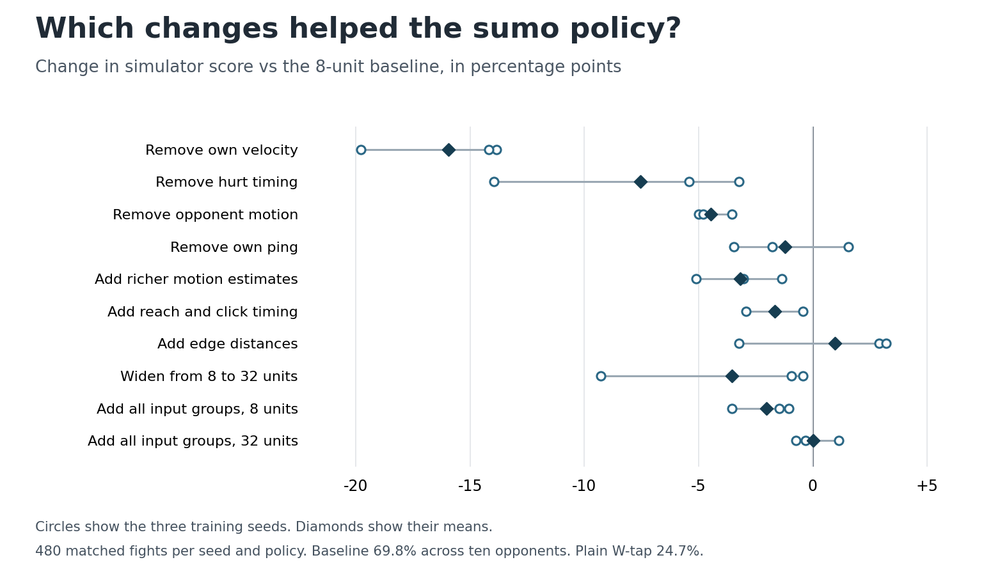

# What helps a Minecraft sumo policy?

The most valuable input we isolated was the bot’s own vertical velocity. On four fresh simulator clocks, hiding that one reading from otherwise identical policies reduced the ten-opponent score from 67.1% to 49.5%. Hiding all three velocity components reduced it to 41.8%. Plain 20-CPS W-tap scored 28.0% on the same fights. Scores award one point for a ring-out win and half a point for a draw.

The effect showed up against a difficult opponent on the live Minecraft server. The intact policy beat shift-check twice, lost once and drew once. With vertical velocity hidden it lost twice and drew twice. With all own velocity hidden it lost all four. Both intact and vertical-blind policies beat W-tap four times. Each matchup covered both starting sides and both assignments of 31 and 109 ms added RTT. [Individual velocity experiments](axes/results.md)

## What the bot does with the information

Vertical velocity distinguishes rising from falling even when two snapshots have the same height and both players are airborne. On 6,003 actual client decisions we could replay the same observations, change one reading, and see which keys changed. Removing vertical velocity changed the forward or sprint choice on 5.1% of decisions, the strafe choice on 4.7%, and the jump choice on 0.2%. A decision can change more than one key.

For all three velocity components together, the timing of the difference was striking. During the 150 ms after both players showed a hurt cue, the movement or attack choice changed on 128 of 209 decisions (61.2%). When neither had a recent cue, it changed on 528 of 5,003 (10.6%). This supports using the knockback arc to time horizontal movement during trades. Recognizing the exact tick of a future landing is a further hypothesis. These are decisions on the original trajectories, and repeated ticks from a long fight are correlated. [Native decision replay and matchup breakdown](sensitivity.md)

## What survived retraining

Thirty-three PPO fits compared eleven configurations at three matched seeds. Every fit started from the same incumbent policy and received 10,240 training fights. Training randomized the two players’ physical RTTs independently. All new policies in this comparison could see their own RTT except the blind arm. The earlier two-ping policy remained a tournament opponent and control.

- **Existing inputs.** Across the ten-opponent simulator field, base8 scored 69.8%. Removing own motion reduced that to 53.9%, removing hurt timing to 62.3%, and removing immediate opponent displacement to 65.3%. Across the six learned opponents alone, removing own velocity cut the score from 50.8% to 24.7%. Against W-tap the same comparison was 93.8% to 94.4%.
- **Own ping.** With the incumbent’s weights frozen, an accurate reading earned 338 of 480 possible points versus 319.5 with the input fixed at 80 ms. At a physical 80/80 ms all 120 outcomes agreed exactly. On the native screen the accurate copy went 5–1–2 and the neutral copy 4–3–1. When allowed to retrain without that input the three seed changes were +1.6, −3.4 and −1.8 points. The feature was useful to this incumbent, with a smaller and less consistent effect after retraining.
- **Size and extra inputs.** Widening the one-hidden-layer softsign MLP from eight to 32 units with the original observations averaged 66.2%. Giving the wide network all additional observations brought it to 69.8%. Adding edge clearance alone to the eight-unit actor averaged 70.8%, with seed changes of +2.9, −3.2 and +3.2 points. Extra motion estimates averaged 66.6%, and reach margin plus physical click age averaged 68.1%. These comparisons use the same training budget and checkpoint rule. [Seed results, native controls and same-weight feature switches](results.md)

## Which bots won?

The eight-unit edge policy won all eight games in the native screen. On independent confirmation it beat W-tap 4–0 and the reply policy 3–1, but lost 0–4 to the same shift-check opponent it had swept in screening. Across 257 historical opponents in the simulator, it scored 96.4% versus 95.4% for the incumbent and 58.3% for plain W-tap. Its narrowest historical matchup was 13–11 against v3-memory-27. The prior two-ping policy won confirmation at 9–3, including 4–0 against W-tap. The registered promotion rule retained v4-ppo-g0496 as best-sumo. [Native results](results.md) · [Title decision](historical-title.json)

A further six fits isolated the effect of spending half the training draws on the three hardest development opponents. Compared with continuing uniformly for the same 12,288 fights per seed, the simulated changes were −4.8, +5.8 and +1.9 points. In Minecraft both selected policies beat W-tap 4–0. Against the targeted sprint-link opponent the uniform policy won 3–1 and the focused policy lost 1–3. The uniform continuation is playable as sumo-input-refinement. [Hard-opponent experiment](refine/results.md)

Finally, we selected four previously trained networks out of 210 possible groups on development. Pooling their action scores and averaging their weights each earned 97.3% against the 257 archived opponents in a fresh simulation. The incumbent earned 96.0% and plain W-tap 59.6%. On the ten-opponent field the same policies scored 68.6% and 69.7%, with the incumbent at 69.1% and W-tap at 27.2%. The historical advantage did little to separate them from the incumbent on the stronger field. [Pooling and averaging](ensemble/results.md)

The best individual member won that native bracket. This was edge8-7181, a different training seed from the edge8-66047 screening winner. It won four against W-tap, then went 2–1–1 against the incumbent and 2–1–1 against shift-check. Across both foes and W-tap it went 5–1–0 in seat A and 3–1–2 in seat B. With the faster link it went 5–0–1 and with the slower link it went 3–2–1. The pooled policy went 8–4–0, with the same 4–2 record at either ping. Plain W-tap went 0–12–0 on this independent panel. Each opponent and policy had four games, one per seat and ping assignment.

To duel the individual winner on the main server, use `/duel sumo-vote-final sumo preset=mmc`. The independent confirmation winner is `/duel sumo-input-final sumo preset=mmc`. The opening-round winner and uniform-training winner are available as `sumo-input-screen` and `sumo-input-refinement`.

## What was verified

The 39 PPO runs used 411,648 training bouts. After fitting, the four studies recorded 90,368 simulator evaluations and 348 distinct scored native bouts on the recorded 137-block MMC floor. Across those native bouts, 362,484 movement decisions were verified, 176,667 physical clicks were counted, and the shortest inter-click interval was 50.006 ms. Six further native W-tap mirrors supplied timing only. The remaining timing donors came from already counted native battles. [Counts and evidence](verification.json) · [Frozen protocols](protocol.md)

After publication, each of the four winners played one extra native duel against W-tap under its in-game alias. All four loaded and passed the physical-control audit. These four launch checks are separate from the tournament scores. [Published-bot checks](published-audit.json)

The widest test used 257 archived opponent identities. The ten-opponent test includes current learned rivals that are more difficult than most of that archive. All experiments here score MMC sumo ring-outs. Independent elite players, boxing scores and other knockback presets require their own evaluations.
