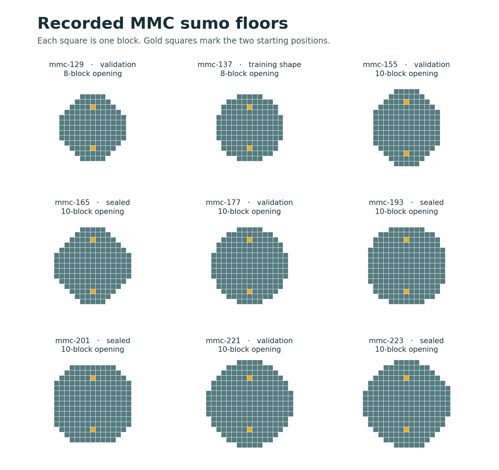

# MMC sumo platform

The test server and regulation sumo simulator use a 13×13 platform with 137 floor blocks. The players start on gold blocks eight blocks apart. Walking straight back from either spawn takes 2.5 blocks to the edge of the top surface. A player's 0.6-block-wide body can extend past that edge while still touching the floor.

Nomophobia's practice mod bookmarked 430 sumo rounds across 19 MMC connections. We identified both countdown spawns and the connected platform below them in 429 rounds. The most frequent exact footprint and start gap appeared in 222 rounds across 17 connections. MMC used several other maps, including a different 13-block-wide footprint. The survey counts appearances in these recordings.

The copied floor comes from clip `fb302faee0f03c27bcaac437a64752fa`. It contained 74 stone, 32 stone brick, 29 mossy stone brick and two gold blocks. All 137 floor cells had two empty blocks directly overhead. We rotated the floor 90 degrees clockwise to put the gold blocks on the lab's usual approach axis. The lab keeps its own platform elevation and ring-out rule. Players lose when their feet fall half a block below the top surface.

```text
....#####....
..#########..
.###########.
.###########.
#############
#############
##A#######B##
#############
#############
.###########.
.###########.
..#########..
....#####....
```

A normal `/duel wtap sumo preset=mmc` selects the measured platform. An explicit `diameter=10` selects the former 80-block lab disk and six-block opening. The server also preserves the sizes of old replays.

The main server played three consecutive validation duels in the same arena slot. The default in m4513 matched all 256 recorded floor and surrounding air cells in a 16×16 square. M4514 selected the older disk. M4516 restored the recorded floor and gold markers. Both players occupied the expected spawn centers in all 41 countdown frames of each duel, and all three ended in ring-outs. [Live block hashes and spawn coordinates](evidence/live-verification.json)

## Reproducing the measurement

The decoder verifies the server name and Minecraft protocol 47. It reconstructs received chunk sections and subsequent block changes up to a stationary countdown frame, then flood-fills the fighting surface. It requires a known perimeter and a connected path between the players. One bookmark had only one frame with the opposing spawn visible and was excluded.

```sh
mkdir -p build/mmc-survey
cp research/mmc-arena/evidence/bookmarks.json build/mmc-survey/
python3 research/mmc-arena/survey.py build/mmc-survey --retry-errors --publish build/mmc-survey/results
```

[Survey counts](evidence/survey.json) · [Source block states and spawns](evidence/platform.json) · [Per-match measurements](evidence/measurements.jsonl.gz)

## Other recorded platforms

Use `map=` in a sumo duel to select a recorded build. For example, `/duel best-sumo sumo preset=mmc cps=7 map=mmc-129` uses the alternate eight-block opening. Map names give the number of connected floor blocks. A suffix such as `mmc-177-04` selects a different material layout on the same footprint. Named maps preserve the original compass direction so stairs face the same way as in the recording.

The public server build includes all 28 arenas. Older experiments sometimes load their original server binary for a block of matches. The lab restores the public build when that block releases the server.

| Use | Playable floor cells | Gold-to-gold distance |
| --- | --- | --- |
| Training default | 137 | 8 |
| Routine map validation | 129 | 8 |
| Routine map validation | 155, 177, 221 | 10 |
| Reserved for the frozen final comparison | 165, 193, 201, 223 | 10 |



The 429 measured rounds contained nine outlines and 28 combinations of floor materials and spawn orientation. We recovered each seven-layer volume twice from different recordings. All 28 pairs matched block for block, including material metadata, both gold markers and a one-block margin. A subsequent scan of every measured round reproduced exactly one of those 28 volumes in all 429 cases. [Per-recording volume hashes](evidence/platforms/all-volumes.json.gz) Each volume extends two layers below the fighting floor and four above it. The lab supplies its own surroundings and ring-out height. [Geometry split and recording IDs](evidence/platforms/split.json) · [Block-state cross-checks](evidence/platforms/catalog.json)

The simulator queries the stock Minecraft 1.8.9 block implementations for the collision boxes of each cell with its recorded neighbors. It uses those boxes for vertical movement, horizontal movement and step-ups. A separate test ran the same moves through Minecraft's `Entity.moveEntity` and compared the six bounding-box endpoints and all three collision flags exactly. [Collision hashes](evidence/platforms/collision/proof.json) · [Movement tests per map](evidence/platforms/collision/move-parity.json)

On `mmc-177-03`, 28 sand blocks lie at the bottom of the copied volume. All 20 recordings of that build show sandstone directly under each one. The lab places that extra support before placing the sand so it stays in place when Minecraft updates the blocks. [Recorded supports](evidence/platforms/falling-block-supports.json)

### Interpreting the validation games

All specialists train on the original 137-block arena. The comparison includes its original lab orientation and the recorded orientation, in addition to the four routine validation maps. Compare `mmc-129` to `mmc-137` to study changing the edge with the same opening distance and approach direction. The larger maps also change opening distance. A score across these floors describes transfer against the specific frozen opponent. Independent human competition remains a separate test. [Frozen match protocol](evidence/platforms/tournaments/baseline16k/protocol.json)

Each tournament report shows simulator and native scores separately with matched W-tap controls. [16,384 training fights](evidence/platforms/tournaments/baseline16k/results.md) · [32,768 training fights](evidence/platforms/tournaments/checkpoint32k/results.md) · [65,536 training fights](evidence/platforms/tournaments/checkpoint64k/results.md)

On the two recorded floors with 137 and 221 blocks, we also tested both start distances in the simulator while holding the midpoint fixed. The larger floor cost the 32k specialist about ten percentage points in outright wins against Sumo Seven. The estimated change from moving the start positions alone was zero, with an approximate 95% interval of −7.8 to +7.8 points. [Opening-distance experiment](evidence/platforms/opening-contrast/README.md)

Every published league winner also plays both plain W-tap and its weakest distinct tournament opponent on these four validation floors. Each generation gets 128 simulator bouts and eight native repetitions per floor and matchup, alongside matched plain W-tap controls. [First league winner](evidence/platforms/tournaments/league-001/results.md)

To play the 65,536-fight Sumo Seven specialist on the larger map, use `/duel sumo-counter-seven-64k sumo preset=mmc cps=7 map=mmc-221`. The separate specialist trained against the first league winner is `sumo-counter-league001-64k`. [Results across 24 timing recordings](../elite-league/single-sumo/evidence/long-specialists/midpoint-timing/after-65536/README.md)
